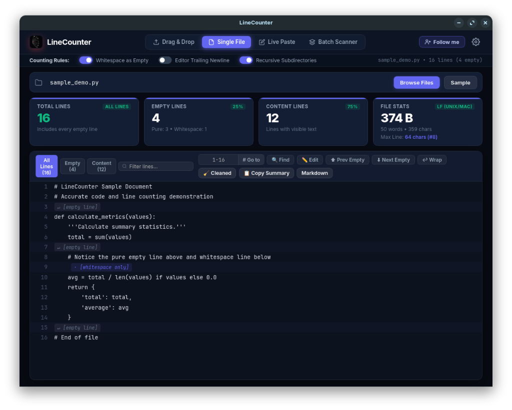
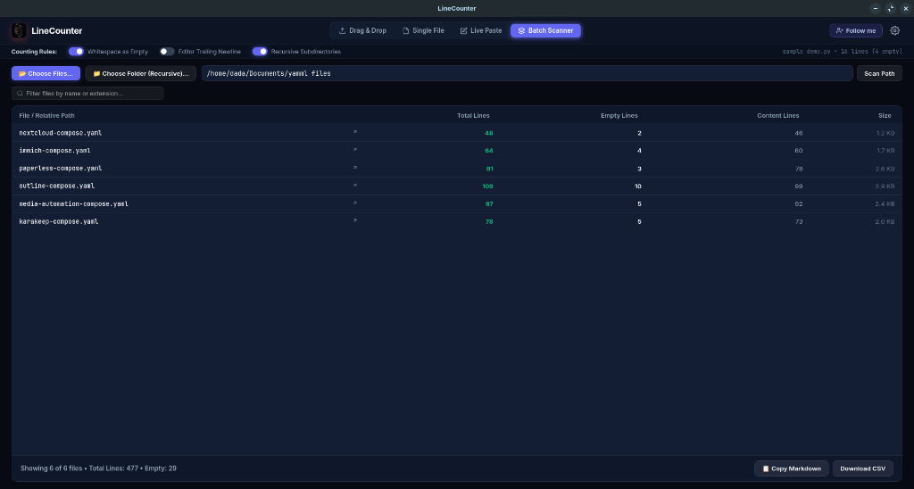
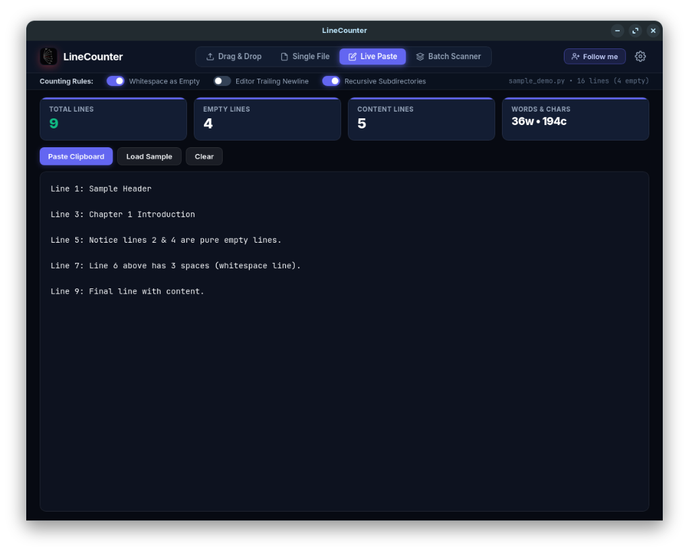
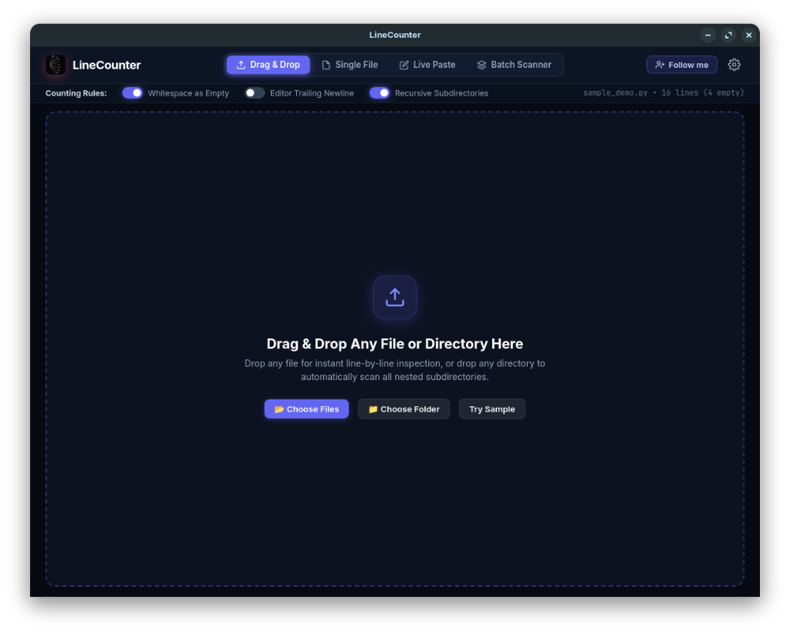

# 📄 LineCounter

<div align="center">
  
  <h2>LineCounter</h2>
  <p><b>Ultra-fast, accurate code and line counter with native desktop GUI and terminal CLI.</b></p>
  <p>Counts <b>every single line</b> — including pure empty lines (<code>\n\n</code>), whitespace-only lines, content lines, words, and characters.</p>

  <p>
    <a href="https://github.com/amma-dada/linecounter/releases"></a>
    <a href="LICENSE"></a>
    
    <a href="https://ko-fi.com/dada0mortada"></a>
  </p>
</div>

---

## 📸 Screenshots

| 1. Single File Inspector | 2. Batch Directory Scanner |
| :---: | :---: |
| <a href="assets/screenshots/02-single-file.png"></a> | <a href="assets/screenshots/04-batch-scanner.png"></a> |
| **3. Live Paste Counter** | **Universal Drag & Drop** |
| <a href="assets/screenshots/03-live-paste.png"></a> | <a href="assets/screenshots/01-drag-drop.png"></a> |

---

## 🚀 Installation

### 🪟 Windows

LineCounter is a 100% native desktop application. All dependencies and UI resources are bundled directly inside the binary — **no local servers, no ports, no network connections, and no background services needed**.

Choose your preferred format from the [Releases page](https://github.com/amma-dada/linecounter/releases):

- **Installer (`.exe` Setup)**: Download **[LineCounter-Setup-x64.exe](https://github.com/amma-dada/linecounter/releases)** (installs to Program Files with Desktop and Start Menu shortcuts).
- **Portable Standalone (`.exe`)**: Download **[LineCounter-Windows-Portable.exe](https://github.com/amma-dada/linecounter/releases)** (runs immediately with zero installation required).
- **Terminal CLI (`.exe`)**: Download **[LineCounter-CLI-Windows.exe](https://github.com/amma-dada/linecounter/releases)** for Command Prompt and PowerShell.

---

### 🐧 Linux

LineCounter runs on all major Linux distributions (**Ubuntu, Debian, Fedora, Arch Linux, openSUSE, Pop!_OS, Linux Mint**, etc.) with full Wayland and X11 support:

#### 1. Standalone Linux Binary (Recommended for any Distro)

Download the pre-compiled, self-contained standalone binary with zero external package manager required:

1. **Download via Terminal**:
   ```bash
   curl -LO https://github.com/amma-dada/linecounter/releases/latest/download/LineCounter-Linux
   ```
   *(Or download directly from [Releases](https://github.com/amma-dada/linecounter/releases/latest/download/LineCounter-Linux) in your browser)*

2. **Make Executable**:
   - **Terminal command**:
     ```bash
     chmod +x LineCounter-Linux
     ```
   - **GUI File Manager**: Right-click `LineCounter-Linux` → **Properties** → **Permissions** → check **Allow executing file as program**.

3. **Run LineCounter**:
   ```bash
   ./LineCounter-Linux
   ```

4. **Install to System (Run from anywhere — Optional)**:
   Move the binary to your local bin directory to launch it from any terminal session or directory:
   ```bash
   mkdir -p ~/.local/bin
   mv LineCounter-Linux ~/.local/bin/linecounter
   ```
   *Now simply type `linecounter` in any terminal to launch!*

---

#### 2. Debian / Ubuntu Package (`.deb`)

For **Ubuntu, Debian, Linux Mint, Pop!_OS, Zorin OS, and elementary OS**:

```bash
# 1. Download the package
wget https://github.com/amma-dada/linecounter/releases/latest/download/linecounter_1.0.0_amd64.deb

# 2. Install the package
sudo dpkg -i linecounter_1.0.0_amd64.deb

# 3. Resolve any missing system libraries if prompted
sudo apt install -f
```
*Adds LineCounter directly to your desktop Application Menu, sets up desktop icons, and configures file associations.*

---

#### 3. One-Click Native Installer Script

If you cloned the source code, run the bundled installer to automatically integrate LineCounter into your desktop environment with high-resolution app icons:

```bash
git clone https://github.com/amma-dada/linecounter.git
cd linecounter
./install.sh
```
- **To Uninstall cleanly**:
  ```bash
  ./install.sh --uninstall
  ```

---

#### 4. Flatpak (Sandboxed Universal Package)

For a fully isolated sandbox installation with Wayland, X11, and host filesystem access:

```bash
# Build and install locally
./flatpak/build-flatpak.sh

# Run via Flatpak
flatpak run com.linecounter.desktop
```

---

## ✨ Features

- **Accurate Empty Line Counting**: Distinguishes between pure empty lines (`\n`), whitespace-only lines, and content lines.
- **Ultra-Fast Parallel Engine**: SIMD-accelerated line scanning in Rust (`memchr` + `rayon`).
- **Universal Drag & Drop**: Drop files or entire folders anywhere on the window or into embedded dropzones.
- **Single File Inspector**: Line-by-line syntax viewer, empty-line navigation, and 1-click cleaned code export.
- **In-App Code Editor**: Built-in editor with Find & Replace (<kbd>Ctrl</kbd>+<kbd>F</kbd>, <kbd>Ctrl</kbd>+<kbd>H</kbd>), jump to line (<kbd>Ctrl</kbd>+<kbd>G</kbd>), and soft line wrap (<kbd>Ctrl</kbd>+<kbd>W</kbd>).
- **Batch Scanner & Export**: Scan directories and export results as Markdown tables or CSV files.
- **Self-Contained**: Ships with all dependencies bundled inside the application binary.

---

## ⚖️ LineCounter vs. Standard Text Editors

| Feature / Capability | 📄 LineCounter | 🪟 Windows Notepad | 🐧 Linux Text Editor (GNOME / Gedit) |
| :--- | :---: | :---: | :---: |
| **Pure Empty Line Detection (`\n\n`)** | ✅ Distinct Metric | ❌ No | ❌ No |
| **Whitespace-Only Line Detection** | ✅ Distinct Metric | ❌ No | ❌ No |
| **Content vs. Empty Line Ratio** | ✅ Live % Breakdown | ❌ No | ❌ No |
| **Editor Trailing Newline Control** | ✅ Toggle Switch | ❌ Shows ghost line | ❌ POSIX hidden |
| **Recursive Folder Batch Scanning** | ✅ Multi-threaded | ❌ Single file only | ❌ Single file only |
| **High-Performance SIMD Engine** | ✅ Rust (`memchr` + `rayon`) | ❌ Slow / Freezes | ❌ Slow on large files |
| **Large File 60fps Virtualization** | ✅ Chunked DOM | ❌ Freezes on 50MB+ | ❌ UI stuttering |
| **Empty Line Quick Navigation** | ✅ <kbd>Alt</kbd>+<kbd>E</kbd> / <kbd>Alt</kbd>+<kbd>Shift</kbd>+<kbd>E</kbd> | ❌ Manual scroll | ❌ Requires manual regex |
| **1-Click Cleaned Code Export** | ✅ Instant | ❌ Manual deletion | ❌ Regex replacement |
| **Markdown & CSV Report Generation** | ✅ Built-in | ❌ None | ❌ None |
| **Terminal CLI for Scripts & CI/CD** | ✅ Headless CLI | ❌ GUI only | ❌ GUI only (`wc -l` lacks metrics) |

---

## ⌨️ Shortcuts

| Shortcut | Action |
| :--- | :--- |
| <kbd>Ctrl</kbd> + <kbd>F</kbd> | Open Find Widget |
| <kbd>Ctrl</kbd> + <kbd>H</kbd> | Open Find & Replace |
| <kbd>Ctrl</kbd> + <kbd>E</kbd> | Toggle Code Editor Mode |
| <kbd>Ctrl</kbd> + <kbd>S</kbd> | Save Edited File |
| <kbd>Ctrl</kbd> + <kbd>G</kbd> | Go to Line |
| <kbd>Ctrl</kbd> + <kbd>W</kbd> | Toggle Soft Line Wrap |
| <kbd>Alt</kbd> + <kbd>E</kbd> / <kbd>Alt</kbd> + <kbd>Shift</kbd> + <kbd>E</kbd> | Next / Previous Empty Line |
| <kbd>Ctrl</kbd> + <kbd>1</kbd> - <kbd>3</kbd> | Switch Tabs (Single File, Batch Scanner, Live Paste) |

---

## 💻 Terminal CLI

Run headless line counts in scripts, terminal sessions, or CI/CD pipelines:

### Windows (PowerShell / Command Prompt)
```powershell
# Count a single file
.\linecounter.exe path\to\file.py

# Recursively scan a folder
.\linecounter.exe path\to\project
```

### Linux (Bash)
```bash
# Count a single file
linecounter path/to/file.py

# Recursively scan a folder
linecounter path/to/project
```

---

## 📬 Contact

Developed and maintained by **Mortada (Dada)**.

- **LinkedIn**: [Ahmed Mortada Zidane](https://www.linkedin.com/in/ahmed-mortada-zidane) — Connect
- **Email**: [mortada6333@gmail.com](mailto:mortada6333@gmail.com) — Feedback
- **Ko-fi**: [ko-fi.com/dada0mortada](https://ko-fi.com/dada0mortada) — Buy Me a Tea

---

## 📄 License & Logo

- **Code License**: [Apache License 2.0](LICENSE).
- **Logo & Artwork**: The official logo and app icon artwork is original copyright and trademark of **Mortada (Dada)**. The name "LineCounter" is free and unrestricted for anyone to use.
